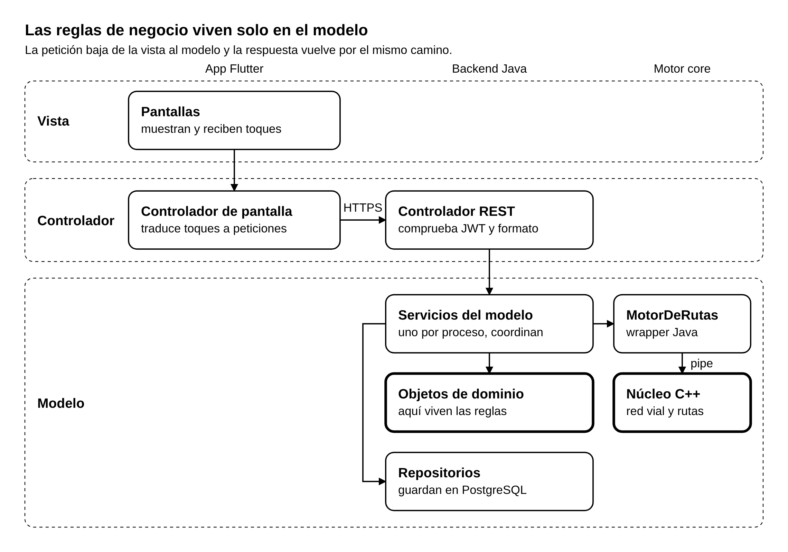

# Aplicación de MVC

[Índice de la arquitectura](README.md)

ChuroViaje usa un solo MVC que atraviesa los componentes: la vista está en la app, el modelo en el servidor y el controlador en las dos orillas. Las reglas de negocio viven únicamente en el modelo.



*Figura: Capas MVC de ChuroViaje · una vista, dos controladores y el modelo en el servidor. Fuente editable: [ARQ-02_CapasMVC.puml](diagramas/ARQ-02_CapasMVC.puml).*

Los dos recuadros resaltados son los únicos lugares donde hay reglas de negocio: los objetos de dominio del backend y el núcleo C++ del motor core.

## Qué es cada capa

| Capa | Dónde vive | Qué hace | Qué no hace |
| --- | --- | --- | --- |
| Vista | Pantallas de la app Flutter | Muestra datos y captura los toques del conductor | Llamar al backend, calcular vigencias, decidir qué es válido |
| Controlador de pantalla | App Flutter, uno por pantalla o flujo | Convierte un toque en una petición, guarda el estado de la pantalla, programa la consulta de cada 5 segundos y maneja la cola sin conexión | Aplicar reglas de negocio |
| Controlador REST | Backend, con Spring | Comprueba el JWT y el formato de la petición, llama al servicio del modelo y traduce el resultado a una respuesta HTTP con un DTO ([D-43](08_decisiones_parametros.md)) | Aplicar reglas de negocio, acceder a la base de datos, devolver un objeto de dominio |
| Modelo | Backend y motor core | Contiene los objetos de dominio, sus reglas y sus datos | Saber de pantallas o de HTTP |

## Cómo se organiza el modelo

- **Objetos de dominio.** Cada uno guarda sus datos y hace cumplir sus propias reglas. Un `EventoVial` sabe si sigue vigente y si un conductor ya lo votó; nadie más lo calcula por él. Se crean con sus datos obligatorios, se validan a sí mismos (por ejemplo, con un método `isValid`) y nunca acceden a la base de datos ([D-41](08_decisiones_parametros.md)).
- **Servicios del modelo.** Hay uno por proceso y cada uno es un caso de uso. Reciben sus repositorios por el constructor y coordinan a los objetos de dominio y a los repositorios para completarlo: crean o recuperan el objeto de dominio, le piden validarse y guardan el resultado, pero no deciden reglas. La única excepción es el ciclo de una fuente automática, que describe la regla de reparto 6.
- **Repositorios.** Guardan y recuperan objetos de dominio en PostgreSQL. No contienen reglas. La interfaz es parte del modelo y su implementación vive en `infraestructura/pg` ([D-41](08_decisiones_parametros.md)); accede con JDBC y sentencias preparadas, con una conexión del pool ([D-37](08_decisiones_parametros.md), [D-39](08_decisiones_parametros.md)).
- **DTO.** Un `record` de solo lectura con los datos que una consulta lleva hasta el controlador y, desde él, hasta la app. No tiene reglas ni setters, y el controlador nunca devuelve un objeto de dominio ([D-42](08_decisiones_parametros.md), [D-43](08_decisiones_parametros.md)).
- **Cliente de ANH.** Hace las llamadas HTTPS a ANH con la espera y los reintentos que le fija la tarea periódica, y entrega las respuestas al modelo. No decide qué se acepta: validar lo que ANH responde y traducir sus litros lo hace `ReporteANH` ([CU-09](04_reglas/CU-09_ConsultarEstadoANH.md)).
- **Motor core.** Es la parte del modelo que conoce la red vial. Tiene dos partes ([D-15](08_decisiones_parametros.md)):
  - **Wrapper `MotorDeRutas`, en Java.** Es lo único que el resto del modelo ve: un objeto Java más dentro del backend. Traduce cada llamada a un mensaje para el núcleo, pone en fila las peticiones y vuelve a arrancar el núcleo si deja de responder. No decide reglas.
  - **Núcleo, en C++.** Mantiene la red vial en memoria y hace cumplir las reglas de los objetos de dominio que viven en el motor core, como `RedVial` y `Tramo`. Corre como un proceso aparte y solo habla con el wrapper, por pipe.

  El resto del modelo no sabe que detrás hay otro programa ni cómo se le habla.

## Capas del backend

Dentro del backend, una petición recorre tres capas y cada una solo llama a la siguiente ([D-41](08_decisiones_parametros.md)):

```
Controlador  ->  Servicio  ->  Repositorio (interfaz)  ->  Implementación para PostgreSQL  ->  Base de datos
(intención)      (caso de uso)  (guarda y consulta)          (JDBC, sentencias preparadas)
```

| Capa | Paquete del backend | Qué contiene |
| --- | --- | --- |
| Controlador | `controladores` | Los controladores REST. Solo mandan la intención al servicio y devuelven un DTO |
| Modelo | `servicios` | Un servicio por caso de uso, que recibe sus repositorios por el constructor |
| Modelo | `dominio` | Los objetos de dominio, los DTO de consulta y las interfaces de los repositorios (por ejemplo `EventoRepository`) |
| Infraestructura | `infraestructura/pg` | La implementación de cada repositorio para PostgreSQL (por ejemplo `PgEventoRepository`) |

- **Solo el repositorio toca la base de datos.** Los objetos de dominio nunca acceden a ella, y tampoco el controlador ni el servicio.
- **Consultar es el caso más simple.** El servicio le pide el DTO al repositorio y lo devuelve tal cual.
- **Crear o modificar.** El servicio pide al repositorio el siguiente identificador o el objeto de dominio, lo crea o lo modifica, le pide validarse y, si es válido, lo guarda.
- **Qué devuelve cada operación del repositorio.** Una consulta para mostrar devuelve DTO; buscar un objeto por su identificador para operar con sus reglas devuelve el objeto de dominio ([D-42](08_decisiones_parametros.md)).

## Reglas de reparto

1. **Una regla, un solo lugar.** Toda regla de negocio está en un objeto de dominio del backend o del motor core. Las reglas de ciclo de una fuente automática (cada cuánto consulta, espera, reintentos y registro) son la excepción y se explican en la regla 6.
2. **La app no es fuente de verdad.** Lo que la app valida es para comodidad del conductor; el backend vuelve a validarlo siempre.
3. **Excepción sin conexión.** La app repite una sola regla, porque debe funcionar sin red: la vigencia de un reporte que espera en la cola local (HU-02). Usa los tiempos de vigencia que el backend le entrega, no valores propios.
4. **Un solo camino.** Una petición va de la vista al controlador y del controlador al modelo; la respuesta vuelve por el mismo camino. Los controladores no se llaman entre sí. Dentro del backend, el controlador llama a un servicio y el servicio al repositorio: el controlador nunca llama a un repositorio.
5. **Clientes sin vista.** El servicio de WhatsApp/LLM y el simulador no tienen vista: entran al backend por un controlador REST, igual que la app.
6. **Reglas de las fuentes automáticas.** El servicio de WhatsApp/LLM cumple las reglas de su propio proceso (qué guarda, cuándo analiza, qué descarta). La consulta a ANH la hace una tarea periódica dentro del backend, que es un servicio del modelo y no tiene controlador REST. Esa tarea cumple las reglas de su ciclo (RN-09.1 a RN-09.4, RN-09.16 y RN-09.19) y los objetos de dominio `ReporteANH`, `Surtidor` y `EstadoCombustible` cumplen todas las demás. En los dos casos, lo que se acepta como estado de un surtidor lo decide el modelo del backend.
7. **Acceso a datos.** Solo las implementaciones de repositorio hablan con PostgreSQL. Ni el controlador, ni los servicios, ni los objetos de dominio abren conexiones ni escriben SQL ([D-41](08_decisiones_parametros.md)).

## Vistas de la app

| Vista | Proceso | Qué muestra y qué permite |
| --- | --- | --- |
| Inicio de sesión | CU-08 | El botón «Iniciar sesión con Google» y el enlace a la política de privacidad. Es la única vista disponible sin sesión |
| Mapa principal | CU-02, CU-05, CU-08 | El mapa con los eventos vigentes por color y los surtidores como marcadores, que se actualizan cada 60 segundos ([D-25](08_decisiones_parametros.md)), el menú de la cuenta con «Cerrar sesión» y la barra inferior (Mapa, Eventos, Surtidores). No hay buscador de lugares mientras no se decida P-19 ([D-24](08_decisiones_parametros.md)) |
| Reportar evento | CU-01 | Tipo de evento y hace cuánto ocurrió, con «Hace 5 minutos» marcado; ajuste manual del punto si falla el GPS |
| Lista y detalle de eventos | CU-02 | Tipo y antigüedad de cada evento, los botones para votar real o falso y la marca de confirmado |
| Cómo llegar | CU-03 | Origen, destino y paradas; la ruta con su tiempo y su distancia; el botón para iniciar |
| Navegación activa | CU-03, CU-04 | La calle que sigue y el sentido del giro, que la app calcula con el trazado ([D-22](08_decisiones_parametros.md)); si un evento afecta lo que falta de la ruta, el aviso de ruta alternativa para aceptar o rechazar, que se cierra solo a los 15 segundos ([D-19](08_decisiones_parametros.md)) |
| Surtidores | CU-05 | Cada surtidor con su estado por tipo de combustible, la fila, el origen del dato (WhatsApp, Conductores o ANH) y su fecha. Si el origen es ANH, también el saldo en litros y el estado de ANH (alto, medio o bajo). Mientras está abierta, se actualiza cada 60 segundos |
| Pregunta de recarga | CU-05 | «¿Acabas de recargar combustible?» y, si la respuesta es sí, los tipos de combustible |

CU-06 y CU-09 no tienen vista: son procesos automáticos. CU-07 se opera por línea de comandos o con un archivo de configuración.
