# Camino crítico del backlog de Construcción

[Índice del backlog](README.md) · [Estimación](07_Estimacion.md)

Este archivo lo genera [camino_critico.py](camino_critico.py) con la columna «Depende de» de [00_Indice_de_subida.md](00_Indice_de_subida.md) y las tallas y responsables de [07_Estimacion.md](07_Estimacion.md). No se edita a mano: se cambia el índice o la estimación y se vuelve a correr el script. `sincronizar_issues.py` también lo regenera cuando aplica cambios.

## Camino crítico

Es la cadena de dependencias que más puntos suma: 13 issues y 47 puntos, del sprint 1 al 7. Si uno de ellos se atrasa, se atrasan los que le siguen, así que sus Pull Requests tienen prioridad en las revisiones.

| Paso | Issue | Título | Sprint | Responsable | Talla | Puntos acumulados |
| --- | --- | --- | --- | --- | --- | --- |
| 1 | #40 | [T-088][Java] Estructura base del backend | 1 | Jorge | M | 3 |
| 2 | #41 | [T-089][Java] Base de datos, catálogos y zona de cobertura | 1 | Antonio | M | 6 |
| 3 | #46 | [HU-10][CU-08][Java] Iniciar sesión con Google y emitir el JWT | 2 | Antonio | L | 11 |
| 4 | #47 | [T-094][Java] Catálogos para la app | 2 | Antonio | S | 13 |
| 5 | #53 | [HU-01][CU-01][Java] Registrar reportes de eventos viales | 3 | Jorge | L | 18 |
| 6 | #55 | [HU-03][CU-02][Java] Consultar eventos vigentes y vencerlos | 3 | Antonio | L | 23 |
| 7 | #63 | [HU-11][CU-02][Java] Votar eventos | 4 | Antonio | M | 26 |
| 8 | #67 | [T-099][Java] Mantener al día el tráfico del motor | 4 | Jorge | M | 29 |
| 9 | #74 | [HU-13][CU-04][Java] Recibir telemetría y registrar congestión | 5 | Jorge | M | 32 |
| 10 | #84 | [HU-09][CU-07][Java] Soporte para el simulador | 6 | Jorge | L | 37 |
| 11 | #87 | [HU-09][CU-07][Simulador] Usuarios fantasma que envían eventos y telemetría | 6 | Antonio | L | 42 |
| 12 | #89 | [T-108][Simulador] Pruebas de carga y reporte | 7 | Antonio | M | 45 |
| 13 | #90 | [T-109][C++] Rendimiento con la red real de Tarija | 7 | Marcelo | S | 47 |

```mermaid
flowchart TB
    subgraph S1["Sprint 1"]
    direction LR
        i2["#40 · Java<br/>Estructura base del backend<br/>Jorge · M"]
        i3["#41 · Java<br/>Base de datos, catálogos y zona de cobertura<br/>Antonio · M"]
    end
    subgraph S2["Sprint 2"]
    direction LR
        i8["#46 · Java<br/>Iniciar sesión con Google y emitir el JWT<br/>Antonio · L"]
        i9["#47 · Java<br/>Catálogos para la app<br/>Antonio · S"]
    end
    subgraph S3["Sprint 3"]
    direction LR
        i15["#53 · Java<br/>Registrar reportes de eventos viales<br/>Jorge · L"]
        i17["#55 · Java<br/>Consultar eventos vigentes y vencerlos<br/>Antonio · L"]
    end
    subgraph S4["Sprint 4"]
    direction LR
        i25["#63 · Java<br/>Votar eventos<br/>Antonio · M"]
        i29["#67 · Java<br/>Mantener al día el tráfico del motor<br/>Jorge · M"]
    end
    subgraph S5["Sprint 5"]
    direction LR
        i36["#74 · Java<br/>Recibir telemetría y registrar congestión<br/>Jorge · M"]
    end
    subgraph S6["Sprint 6"]
    direction LR
        i46["#84 · Java<br/>Soporte para el simulador<br/>Jorge · L"]
        i49["#87 · Simulador<br/>Usuarios fantasma que envían eventos y telemetría<br/>Antonio · L"]
    end
    subgraph S7["Sprint 7"]
    direction LR
        i51["#89 · Simulador<br/>Pruebas de carga y reporte<br/>Antonio · M"]
        i52["#90 · C++<br/>Rendimiento con la red real de Tarija<br/>Marcelo · S"]
    end
    i2 --> i3 --> i8 --> i9 --> i15 --> i17 --> i25 --> i29 --> i36 --> i46 --> i49 --> i51 --> i52
    classDef alex fill:#cfe2ff,stroke:#666,color:#000
    classDef jorge fill:#d1e7dd,stroke:#666,color:#000
    classDef antonio fill:#fff3cd,stroke:#666,color:#000
    classDef marcelo fill:#e2d9f3,stroke:#666,color:#000
    classDef franz fill:#f8d7da,stroke:#666,color:#000
    class i2,i15,i29,i36,i46 jorge
    class i3,i8,i9,i17,i25,i49,i51 antonio
    class i52 marcelo
```

## Cadenas dentro de un mismo sprint

Cuando un issue depende de otro del mismo sprint, avanza con datos falsos que siguen [05_contratos.md](../../03_des/02_Arquitectura/05_contratos.md) y se conecta de verdad cuando el otro se fusiona. Aun así, una cadena larga dentro de una semana es un riesgo: las de 8 puntos o más conviene empezarlas el primer día y acordar el contrato antes.

| Sprint | Cadena más larga | Puntos | |
| --- | --- | --- | --- |
| 1 | #40 (Jorge, M) → #41 (Antonio, M) | 6 |  |
| 2 | #46 (Antonio, L) → #47 (Antonio, S) → #48 (Alex, L) | 12 | Revisar |
| 3 | #53 (Jorge, L) → #55 (Antonio, L) → #56 (Alex, M) | 13 | Revisar |
| 4 | #63 (Antonio, M) → #67 (Jorge, M) | 6 |  |
| 5 | #73 (Marcelo, L) → #74 (Jorge, M) → #75 (Franz, M) | 11 | Revisar |
| 6 | #84 (Jorge, L) → #87 (Antonio, L) | 10 | Revisar |
| 7 | #88 (Jorge y Antonio, L) | 5 |  |

## Mapa de dependencias

Cada caja es un issue, con su responsable y su talla; el color es el del responsable y el borde rojo marca el camino crítico. Se dibujan solo las dependencias directas: si A → B → C, no se repite A → C. #88 depende de «todos los de Java», así que no lleva flechas. #91 depende de «todos los de sprints anteriores», así que no lleva flechas.

```mermaid
flowchart TB
    subgraph S1["Sprint 1"]
    direction LR
        i1["#39 · Flutter<br/>Estructura base de la app<br/>Alex · M"]
        i2["#40 · Java<br/>Estructura base del backend<br/>Jorge · M"]
        i3["#41 · Java<br/>Base de datos, catálogos y zona de cobertura<br/>Antonio · M"]
        i4["#42 · C++<br/>Estructura del núcleo y protocolo por pipe<br/>Marcelo · M"]
        i5["#43 · WhatsApp/LLM<br/>Estructura del servicio<br/>Franz · S"]
        i6["#44 · Servidor<br/>Preparar la instancia de Oracle Cloud<br/>Marcelo · S"]
    end
    subgraph S2["Sprint 2"]
    direction LR
        i7["#45 · Flutter<br/>Mapa base con Mapbox y ubicación<br/>Alex · M"]
        i8["#46 · Java<br/>Iniciar sesión con Google y emitir el JWT<br/>Antonio · L"]
        i9["#47 · Java<br/>Catálogos para la app<br/>Antonio · S"]
        i10["#48 · Flutter<br/>Iniciar sesión con Google<br/>Alex · L"]
        i11["#49 · Java<br/>Wrapper MotorDeRutas<br/>Jorge · L"]
        i12["#50 · C++<br/>Cargar la red vial en el núcleo<br/>Marcelo · M"]
        i13["#51 · WhatsApp/LLM<br/>Leer los grupos autorizados<br/>Franz · M"]
        i14["#52 · Servidor<br/>Dominio, Nginx y HTTPS<br/>Marcelo · S"]
        i54["#93 · C++<br/>Preparar la red vial de Tarija desde OpenStreetMap<br/>Franz · M"]
        i56["orden 56 · Servidor<br/>Comprobar la salida del servidor hacia la API de ANH<br/>Marcelo · XS"]
    end
    subgraph S3["Sprint 3"]
    direction LR
        i15["#53 · Java<br/>Registrar reportes de eventos viales<br/>Jorge · L"]
        i16["#54 · Flutter<br/>Reportar un evento vial<br/>Alex · M"]
        i17["#55 · Java<br/>Consultar eventos vigentes y vencerlos<br/>Antonio · L"]
        i18["#56 · Flutter<br/>Ver los eventos en el mapa<br/>Alex · M"]
        i19["#57 · Java<br/>Recibir el análisis de WhatsApp<br/>Antonio · M"]
        i20["#58 · C++<br/>Calcular la ruta óptima con A*<br/>Marcelo · M"]
        i21["#59 · WhatsApp/LLM<br/>Analizar los mensajes por lotes y enviar el resultado<br/>Franz · L"]
        i22["#60 · Servidor<br/>Desplegar el backend con el núcleo C++<br/>Marcelo · M"]
        i57["orden 57 · Java<br/>Medir la API de ANH y fijar el ciclo de consulta y la vigencia<br/>Franz · S"]
        i58["orden 58 · Java<br/>Vincular las estaciones de ANH con los surtidores del catálogo<br/>Jorge · S"]
    end
    subgraph S4["Sprint 4"]
    direction LR
        i23["#61 · Flutter<br/>Guardar y reintentar reportes sin conexión<br/>Franz · M"]
        i24["#62 · Flutter<br/>Ver eventos guardados sin conexión<br/>Franz · S"]
        i25["#63 · Java<br/>Votar eventos<br/>Antonio · M"]
        i26["#64 · Flutter<br/>Lista de eventos y votos<br/>Alex · S"]
        i27["#65 · Java<br/>Calcular la ruta<br/>Jorge · S"]
        i28["#66 · C++<br/>Tráfico de los eventos en los tramos<br/>Marcelo · M"]
        i29["#67 · Java<br/>Mantener al día el tráfico del motor<br/>Jorge · M"]
        i30["#68 · Servidor<br/>Desplegar el servicio de WhatsApp/LLM<br/>Marcelo · S"]
        i59["orden 59 · Java<br/>Consultar el estado de combustible desde ANH<br/>Antonio · L"]
    end
    subgraph S5["Sprint 5"]
    direction LR
        i31["#69 · Java<br/>Consultar surtidores cercanos<br/>Antonio · M"]
        i32["#70 · Flutter<br/>Cómo llegar<br/>Alex · L"]
        i33["#71 · Flutter<br/>Consultar surtidores cercanos<br/>Franz · M"]
        i34["#72 · Java<br/>Registrar confirmaciones de recarga<br/>Antonio · M"]
        i35["#73 · C++<br/>Detectar congestión con la telemetría<br/>Marcelo · L"]
        i36["#74 · Java<br/>Recibir telemetría y registrar congestión<br/>Jorge · M"]
        i37["#75 · Flutter<br/>Enviar telemetría con la app abierta<br/>Franz · M"]
        i38["#76 · C++<br/>Revisar la ruta activa<br/>Marcelo · M"]
        i39["#77 · WhatsApp/LLM<br/>Prueba con mensajes reales<br/>Franz · M"]
        i40["#78 · Simulador<br/>Estructura y parámetros del simulador<br/>Antonio · S"]
        i55["#94 · Flutter<br/>Navegación activa<br/>Alex · M"]
    end
    subgraph S6["Sprint 6"]
    direction LR
        i41["#79 · Servidor<br/>Respaldos de la base de datos y registros<br/>Marcelo · M"]
        i42["#80 · Flutter<br/>Preguntar por la recarga<br/>Alex · M"]
        i43["#81 · Flutter<br/>Política de privacidad<br/>Franz · S"]
        i44["#82 · Java<br/>Revisar la ruta activa<br/>Jorge · S"]
        i45["#83 · Flutter<br/>Aviso de ruta alternativa<br/>Alex · M"]
        i46["#84 · Java<br/>Soporte para el simulador<br/>Jorge · L"]
        i47["#85 · Java<br/>Limpieza de datos vencidos<br/>Antonio · XS"]
        i48["#86 · Servidor<br/>Ambiente de pruebas para el simulador<br/>Marcelo · S"]
        i49["#87 · Simulador<br/>Usuarios fantasma que envían eventos y telemetría<br/>Antonio · L"]
    end
    subgraph S7["Sprint 7"]
    direction LR
        i50["#88 · Java<br/>Pruebas de punta a punta<br/>Jorge y Antonio · L"]
        i51["#89 · Simulador<br/>Pruebas de carga y reporte<br/>Antonio · M"]
        i52["#90 · C++<br/>Rendimiento con la red real de Tarija<br/>Marcelo · S"]
        i53["#91 · Servidor<br/>Despliegue final y revisión de seguridad<br/>Marcelo · M"]
    end
    i2 --> i3
    i1 --> i7
    i3 --> i8
    i8 --> i9
    i1 --> i10
    i9 --> i10
    i2 --> i11
    i4 --> i11
    i4 --> i12
    i54 --> i12
    i5 --> i13
    i6 --> i14
    i3 --> i54
    i6 --> i56
    i9 --> i15
    i7 --> i16
    i10 --> i16
    i15 --> i16
    i15 --> i17
    i7 --> i18
    i10 --> i18
    i17 --> i18
    i8 --> i19
    i12 --> i20
    i13 --> i21
    i19 --> i21
    i14 --> i22
    i8 --> i22
    i11 --> i22
    i12 --> i22
    i56 --> i57
    i19 --> i58
    i16 --> i23
    i18 --> i24
    i17 --> i25
    i18 --> i26
    i25 --> i26
    i11 --> i27
    i20 --> i27
    i20 --> i28
    i11 --> i29
    i25 --> i29
    i28 --> i29
    i22 --> i30
    i21 --> i30
    i57 --> i59
    i58 --> i59
    i19 --> i31
    i7 --> i32
    i27 --> i32
    i31 --> i32
    i7 --> i33
    i31 --> i33
    i31 --> i34
    i28 --> i35
    i29 --> i36
    i35 --> i36
    i7 --> i37
    i36 --> i37
    i28 --> i38
    i30 --> i39
    i33 --> i39
    i32 --> i55
    i22 --> i41
    i33 --> i42
    i34 --> i42
    i14 --> i43
    i21 --> i43
    i37 --> i43
    i27 --> i44
    i38 --> i44
    i55 --> i45
    i44 --> i45
    i36 --> i46
    i34 --> i47
    i22 --> i48
    i40 --> i49
    i46 --> i49
    i48 --> i49
    i49 --> i51
    i38 --> i52
    i51 --> i52
    classDef alex fill:#cfe2ff,stroke:#666,color:#000
    classDef jorge fill:#d1e7dd,stroke:#666,color:#000
    classDef antonio fill:#fff3cd,stroke:#666,color:#000
    classDef marcelo fill:#e2d9f3,stroke:#666,color:#000
    classDef franz fill:#f8d7da,stroke:#666,color:#000
    class i1,i7,i10,i16,i18,i26,i32,i42,i45,i55 alex
    class i2,i11,i15,i27,i29,i36,i44,i46,i50,i58 jorge
    class i3,i8,i9,i17,i19,i25,i31,i34,i40,i47,i49,i51,i59 antonio
    class i4,i6,i12,i14,i20,i22,i28,i30,i35,i38,i41,i48,i52,i53,i56 marcelo
    class i5,i13,i21,i23,i24,i33,i37,i39,i43,i54,i57 franz
    style i2 stroke:#d73a49,stroke-width:3px
    style i3 stroke:#d73a49,stroke-width:3px
    style i8 stroke:#d73a49,stroke-width:3px
    style i9 stroke:#d73a49,stroke-width:3px
    style i15 stroke:#d73a49,stroke-width:3px
    style i17 stroke:#d73a49,stroke-width:3px
    style i25 stroke:#d73a49,stroke-width:3px
    style i29 stroke:#d73a49,stroke-width:3px
    style i36 stroke:#d73a49,stroke-width:3px
    style i46 stroke:#d73a49,stroke-width:3px
    style i49 stroke:#d73a49,stroke-width:3px
    style i51 stroke:#d73a49,stroke-width:3px
    style i52 stroke:#d73a49,stroke-width:3px
    linkStyle 0,2,3,14,18,34,41,55,73,77,79,81 stroke:#d73a49,stroke-width:3px
```

Colores: azul Alex, verde Jorge, amarillo Antonio, lila Marcelo, rosado Franz.
